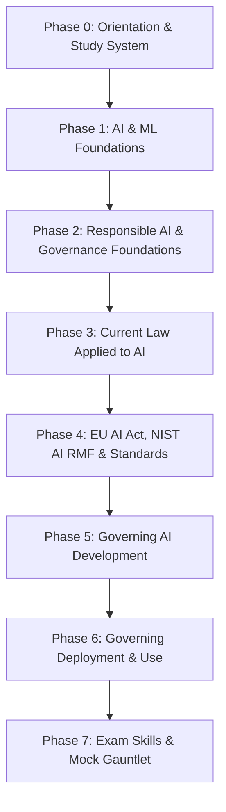

# AIGP Exam Prep — Pass the IAPP AI Governance Professional

<p align="center">
  <b>72 lessons · 8 phases · 165 practice questions · one 8-week timeline.</b><br>
  A complete, phased, time-bound study system for the IAPP AIGP certification,<br>
  mapped lesson-by-lesson to Body of Knowledge v2.1 (effective February 2026).
</p>

<p align="center">
  
  
  
  
  
</p>

> **Unofficial study resource.** This project is not affiliated with, endorsed by, or licensed by the IAPP. It reproduces no IAPP copyrighted material — all content is an original synthesis of public laws, frameworks, and standards. Always verify exam logistics against the current [AIGP Body of Knowledge and Candidate Handbook](https://iapp.org/certify/aigp/), and verify legal specifics against primary sources; AI law changes fast.

---

## The exam, in numbers

| Fact | Value |
|---|---|
| Questions | 100 multiple-choice (85 scored + 15 unscored pilot items) |
| Time | ~165–180 minutes (confirm in your candidate handbook) |
| Scenario-based questions | ~30% of the exam |
| Passing score | 300 on a 100–500 scale |
| Delivery | Pearson VUE test centers or OnVUE remote proctoring |
| Blueprint | BoK v2.1, effective 2026-02-02 — **four domains** |

### BoK v2.1 domains → this curriculum

| BoK Domain | Scored Qs (approx.) | Covered by |
|---|---|---|
| **I. Foundations of AI governance** | 16–20 | Phases 1–2 |
| **II. Laws, standards and frameworks** | 19–23 | Phases 3–4 |
| **III. Governing AI development** | 21–25 | Phase 5 |
| **IV. Governing AI deployment and use** | 21–25 | Phase 6 |
| Exam technique + mocks | — | Phases 0, 7 |

Weight your effort accordingly: **Domains II–IV carry ~70 of 85 scored questions.** The single highest-yield block of content is the EU AI Act; the second is NIST AI RMF + ISO/IEC 42001; the third is lifecycle governance (development + deployment).

## Who this is for

Compliance, privacy, audit, legal, product, and engineering professionals preparing for the AIGP. No technical background is assumed (Phase 1 builds the AI/ML foundations), and no legal background is assumed (Phases 3–4 build the law from zero). If you hold a CIPP/E or CIPM, Phase 3 will be a fast review — the tracks below tell you what to skip.

## Lesson anatomy

Every lesson follows the same 5-beat structure:

| Beat | What it is |
|---|---|
| **EXAM FOCUS** | The BoK competency this maps to, and roughly how it gets tested |
| **CORE** | The substance — definitions, rules, frameworks, with tables over prose |
| **CASES & EXAMPLES** | Concrete scenarios of the kind the exam's scenario questions use |
| **MEMORY HOOKS** | Mnemonics, contrast tables, and the 5 facts to retain if you retain nothing else |
| **SELF-CHECK** | 3–5 recall questions with answers at the bottom |

## Repository layout

```
phases/<N>-<phase-name>/<NN>-<lesson-name>/en.md    # lesson docs
practice/
├── quiz-domain-1.md ... quiz-domain-4.md           # 20 questions each, with rationales
├── mock-exam.md                                    # 85 questions, full rationale key
└── question-journal-template.md
GLOSSARY.md                                          # 150+ terms, exam-weighted
ROADMAP.md                                           # 4 / 8 / 12-week timelines, day-by-day
website/                                             # static study-tracker site
```

## Curriculum map



---

## Phase catalog

### Phase 0 — Orientation & Study System · Week 1 · 4 lessons · ~4h

| # | Lesson | hrs |
|---|--------|-----|
| 01 | The AIGP in 2026: format, scoring, booking, ANAB accreditation, maintenance (CPE) | 1 |
| 02 | BoK v2.1 mapped: where the 85 points live and how to allocate hours | 1 |
| 03 | The study system: active recall, spaced repetition, the question journal | 1 |
| 04 | Baseline diagnostic: 20 questions before you study anything | 1 |

### Phase 1 — AI & ML Foundations · Week 1–2 · 10 lessons · ~10h *(Domain I)*

| # | Lesson | hrs |
|---|--------|-----|
| 01 | What is AI: OECD definition, AI vs automation vs traditional software | 1 |
| 02 | Machine learning types: supervised, unsupervised, reinforcement | 1 |
| 03 | Neural networks & deep learning, explained for governance people | 1 |
| 04 | NLP, computer vision, and the major AI application families | 1 |
| 05 | Generative AI: LLMs, foundation models, fine-tuning, RAG | 1.5 |
| 06 | The AI tech stack: data, compute, models, applications | 1 |
| 07 | Training vs inference; overfitting, drift, and the black-box problem | 1 |
| 08 | AI failure modes: bias, hallucination, brittleness, misuse | 1 |
| 09 | Sociotechnical systems: why AI risk is never just technical | 0.75 |
| 10 | Domain I vocabulary drill: the 40 terms that show up in stems | 0.75 |

### Phase 2 — Responsible AI & Governance Foundations · Week 2–3 · 10 lessons · ~10h *(Domain I)*

| # | Lesson | hrs |
|---|--------|-----|
| 01 | Why AI governance: the harms taxonomy (individual, group, societal) | 1 |
| 02 | Trustworthy AI attributes: valid, safe, secure, accountable, explainable, privacy-enhanced, fair | 1 |
| 03 | Fairness: the competing definitions and why you can't have them all | 1.5 |
| 04 | Transparency & explainability: XAI, disclosures, counterfactuals | 1 |
| 05 | Accountability & human oversight: HITL, HOTL, human-in-command | 1 |
| 06 | Privacy in AI: data protection principles applied to models | 1 |
| 07 | Ethics frameworks: OECD AI Principles, UNESCO, Asilomar lineage | 1 |
| 08 | Building the governance program: charters, policies, committees | 1 |
| 09 | Governance roles: who owns what (board → AI governance lead → teams) | 0.75 |
| 10 | Stakeholder engagement & AI ethics boards in practice | 0.75 |

### Phase 3 — Current Law Applied to AI · Week 3–4 · 10 lessons · ~12h *(Domain II)*

| # | Lesson | hrs |
|---|--------|-----|
| 01 | GDPR × AI: lawful basis, purpose limitation, minimization vs training data | 1.5 |
| 02 | GDPR Article 22: automated decision-making and its exam-favorite edge cases | 1 |
| 03 | DPIAs for AI systems; GDPR fines & enforcement patterns against AI | 1 |
| 04 | US federal: FTC Section 5, EEOC, CFPB, sectoral regulators | 1.5 |
| 05 | US state AI laws: Colorado AI Act, Illinois BIPA, NYC Local Law 144, California | 1.5 |
| 06 | IP & copyright: training data, output ownership, infringement theories | 1.5 |
| 07 | Anti-discrimination law: disparate treatment vs disparate impact in AI | 1 |
| 08 | Product liability & consumer protection meets AI | 1 |
| 09 | Sectoral deep-dives: employment, credit, health, insurance | 1 |
| 10 | Cross-border: data transfers, extraterritoriality, conflicts of law | 1 |

### Phase 4 — EU AI Act, NIST AI RMF & Standards · Week 4–5 · 12 lessons · ~14h *(Domain II — highest yield)*

| # | Lesson | hrs |
|---|--------|-----|
| 01 | EU AI Act: structure, scope, actors (provider, deployer, importer, distributor) | 1.5 |
| 02 | The risk pyramid: prohibited practices (Art. 5) — memorize all of them | 1.5 |
| 03 | High-risk AI: Annex III categories and the classification flowchart | 1.5 |
| 04 | High-risk obligations: risk management, data governance, logging, oversight | 1.5 |
| 05 | GPAI & foundation models: tiers, systemic risk, the Code of Practice | 1.5 |
| 06 | Conformity assessment, CE marking, notified bodies, the EU database | 1 |
| 07 | Enforcement: the AI Office, penalties, and the application timeline | 1 |
| 08 | NIST AI RMF: Govern, Map, Measure, Manage — the exam's backbone framework | 1.5 |
| 09 | ISO/IEC 42001 (AIMS) & 23894 (risk): what certifiable AI management looks like | 1 |
| 10 | Soft law: OECD, Council of Europe Framework Convention, UNESCO, G7 Hiroshima | 1 |
| 11 | Rest of world: UK, Canada, China, Singapore, Brazil, India — one table each | 1 |
| 12 | Crosswalk drill: AI Act ↔ NIST RMF ↔ ISO 42001 — one mapping table to rule them all | 1 |

### Phase 5 — Governing AI Development · Week 5–6 · 10 lessons · ~11h *(Domain III)*

| # | Lesson | hrs |
|---|--------|-----|
| 01 | The AI lifecycle: stages, gates, and where governance intervenes | 1 |
| 02 | Use-case intake: problem definition, feasibility, ban lists | 1 |
| 03 | Data governance for AI: provenance, quality, labeling, minimization | 1.5 |
| 04 | Training governance: documentation, reproducibility, versioning | 1 |
| 05 | Testing & evaluation: accuracy, robustness, fairness testing, red teaming | 1.5 |
| 06 | Impact assessments: AIA vs DPIA vs conformity assessment — when each applies | 1.5 |
| 07 | Documentation artifacts: model cards, datasheets, system cards | 1 |
| 08 | Security in development: adversarial ML, poisoning, supply chain | 1 |
| 09 | Release gates & go/no-go decisions: who signs, on what evidence | 1 |
| 10 | Provider vs deployer obligations across the lifecycle | 0.75 |

### Phase 6 — Governing Deployment & Use · Week 6–7 · 10 lessons · ~11h *(Domain IV)*

| # | Lesson | hrs |
|---|--------|-----|
| 01 | Deployment readiness: checklists, staged rollouts, shadow deployment | 1 |
| 02 | Third-party & vendor AI risk: assessment, contracts, assurances | 1.5 |
| 03 | Procurement: questions to ask before buying AI | 1 |
| 04 | Monitoring in production: drift, performance decay, feedback loops | 1.5 |
| 05 | Human oversight in operation: design, override, automation bias | 1 |
| 06 | User-facing transparency: notices, labels, disclosures | 1 |
| 07 | AI incident response: detection, escalation, serious-incident reporting | 1.5 |
| 08 | Auditing AI systems: internal audit, external audit, algorithmic audits | 1 |
| 09 | Decommissioning: retirement, data disposition, user migration | 0.75 |
| 10 | Organizational change: training, culture, the governance operating rhythm | 0.75 |

### Phase 7 — Exam Skills & Mock Gauntlet · Week 7–8 · 6 lessons · ~10h

| # | Lesson | hrs |
|---|--------|-----|
| 01 | Question anatomy: stems, distractor patterns, scenario-question strategy | 1 |
| 02 | Domain I quiz — 20 questions with full rationales | 1.5 |
| 03 | Domain II quiz — 20 questions with full rationales | 1.5 |
| 04 | Domain III quiz — 20 questions with full rationales | 1.5 |
| 05 | Domain IV quiz — 20 questions with full rationales | 1.5 |
| 06 | **Full mock: 85 questions, timed, with rationale key** + retro protocol | 3 |

---

## Timelines

Three tracks, same content. Full day-by-day plans in [ROADMAP.md](ROADMAP.md). **Book the real exam before you start Week 1** — a fixed date is the single highest-leverage study decision.

| Track | Duration | Pace | Who it's for |
|---|---|---|---|
| **Sprint** | 4 weeks | ~20 h/week | Deadline-driven; privacy/compliance background |
| **Default** | 8 weeks | ~10 h/week | Working professionals, first IAPP cert |
| **Steady** | 12 weeks | ~7 h/week | Busy quarters, no prior privacy/AI exposure |

Rules baked into every track:

- **Questions early and often.** The baseline diagnostic comes before any studying; each domain ends with a quiz; wrong answers enter the question journal and get re-tested at +2 and +7 days.
- **The EU AI Act gets two passes.** Once in Week 4–5, once in the final review week. It is the most-tested, most-detailed content on the exam.
- **Weekly one-page summaries.** End each phase by writing its one-pager from memory, then checking against the lesson MEMORY HOOKS.

## Prior-certification shortcuts

| You hold | Skip / skim | Reinvest the hours in |
|---|---|---|
| CIPP/E | Phase 3 lessons 01–03 (GDPR) → skim | Phase 4 (AI Act detail) + Phase 5 |
| CIPM | Phase 2 lessons 08–10 (program building) → skim | Phases 4 and 6 |
| CIPT | Phase 1 → skim | Phases 3 and 4 |
| None of these | Nothing — take the 12-week track | — |

## License

MIT — free forever. Not affiliated with the IAPP. Verify everything against primary sources before relying on it professionally.
